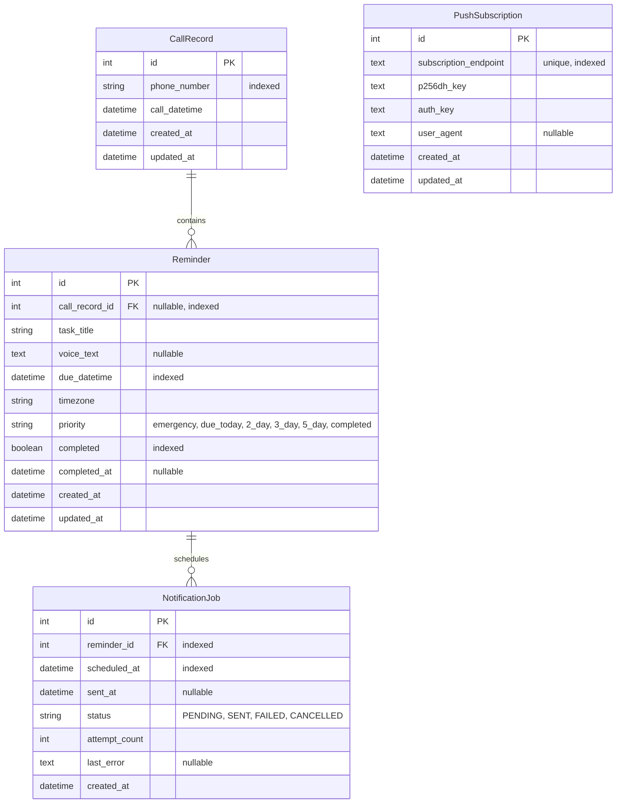

# Smart Call Reminder — Database Design & Schema Specifications

## 1. Schema Diagram (ERD)

## 2. Table Specifications

### 2.1 `call_records`
| Field | Type | Modifiers | Description |
|---|---|---|---|
| `id` | INTEGER | PRIMARY KEY AUTOINCREMENT | Unique ID |
| `phone_number` | VARCHAR(32) | NOT NULL, INDEXED | Normalized international or national phone number (e.g. +919876543210) |
| `call_datetime` | DATETIME | NOT NULL | Timestamp when the call occurred |
| `created_at` | DATETIME | DEFAULT UTC NOW | Record creation timestamp |
| `updated_at` | DATETIME | DEFAULT UTC NOW | Record last modified timestamp |

### 2.2 `reminders`
| Field | Type | Modifiers | Description |
|---|---|---|---|
| `id` | INTEGER | PRIMARY KEY AUTOINCREMENT | Unique ID |
| `call_record_id` | INTEGER | FOREIGN KEY -> call_records.id (ON DELETE CASCADE), NULLABLE, INDEXED | Associated call record |
| `task_title` | VARCHAR(255) | NOT NULL | Brief actionable title |
| `voice_text` | TEXT | NULLABLE | Transcribed audio or typed note |
| `due_datetime` | DATETIME | NOT NULL, INDEXED | Precise due date and time with timezone |
| `timezone` | VARCHAR(64) | DEFAULT 'UTC' | IANA timezone string (e.g. 'Asia/Kolkata') |
| `priority` | VARCHAR(32) | NOT NULL, INDEXED | Priority tier: `emergency`, `due_today`, `2_day`, `3_day`, `5_day`, `completed` |
| `completed` | BOOLEAN | DEFAULT FALSE, INDEXED | Task completion flag |
| `completed_at` | DATETIME | NULLABLE | Completion timestamp |
| `created_at` | DATETIME | DEFAULT UTC NOW | Creation timestamp |
| `updated_at` | DATETIME | DEFAULT UTC NOW | Update timestamp |

### 2.3 `notification_jobs`
| Field | Type | Modifiers | Description |
|---|---|---|---|
| `id` | INTEGER | PRIMARY KEY AUTOINCREMENT | Unique ID |
| `reminder_id` | INTEGER | FOREIGN KEY -> reminders.id (ON DELETE CASCADE), NOT NULL, INDEXED | Target reminder |
| `scheduled_at` | DATETIME | NOT NULL, INDEXED | Trigger timestamp for notification |
| `sent_at` | DATETIME | NULLABLE | When push was dispatched |
| `status` | VARCHAR(32) | DEFAULT 'PENDING', INDEXED | `PENDING`, `SENT`, `FAILED`, `CANCELLED` |
| `attempt_count` | INTEGER | DEFAULT 0 | Delivery retry attempts |
| `last_error` | TEXT | NULLABLE | Error message if dispatch failed |
| `created_at` | DATETIME | DEFAULT UTC NOW | Record creation |

### 2.4 `push_subscriptions`
| Field | Type | Modifiers | Description |
|---|---|---|---|
| `id` | INTEGER | PRIMARY KEY AUTOINCREMENT | Unique ID |
| `subscription_endpoint` | TEXT | UNIQUE, NOT NULL, INDEXED | Browser push service endpoint URL |
| `p256dh_key` | TEXT | NOT NULL | Client public key for message encryption |
| `auth_key` | TEXT | NOT NULL | Client authentication secret |
| `user_agent` | TEXT | NULLABLE | Client browser identifier for diagnostics |
| `created_at` | DATETIME | DEFAULT UTC NOW | Subscription created timestamp |
| `updated_at` | DATETIME | DEFAULT UTC NOW | Subscription refreshed timestamp |

---

## 3. Indexes & Performance Optimization
- `idx_call_records_phone`: Fast lookup of all previous notes for a specific phone number.
- `idx_reminders_due_datetime`: High-speed date range querying for Calendar view and Overdue alerts.
- `idx_notification_jobs_status_sched`: Fast polling query `WHERE status = 'PENDING' AND scheduled_at <= :now`.
